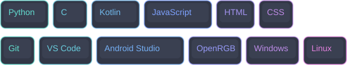

I'm a computer science student who builds small tools for problems I actually have. Lately that means keyboards and Windows housekeeping.

### What I'm building

**[KeyGlow](https://github.com/HiddenOnLies/KeyGlow)** lights up RGB keyboards through OpenRGB. Its profiles adapt between keyboard models, so one lighting setup works across different boards. The community shares them in [KeyGlow-profiles](https://github.com/HiddenOnLies/KeyGlow-profiles) and [KeyGlow-layouts](https://github.com/HiddenOnLies/KeyGlow-layouts).

**[LeftoverSweeper](https://github.com/HiddenOnLies/LeftoverSweeper)** finds the files and registry entries that programs leave behind after you uninstall them on Windows. Everything it removes goes to a quarantine you can restore, with ZIP backups.

### What I work with

